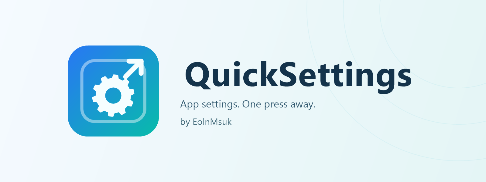

# QuickSettings

**QuickSettings** adds **Settings** to Home Screen 3rd party application long-press context menus.

<picture>
  <source media="(prefers-color-scheme: dark)" srcset="quicksettingsprefs/Resources/banner-dark.png">
  
</picture>

## Installation

1. Navigate to the [Releases page](https://github.com/EolnMsuk/QuickSettings/releases).
2. Download the correct `.deb` for your environment (see table). 
3. Install it via **Sileo** or **Zebra**.

| Download | Environment | Debian architecture |
| --- | --- | --- |
| `com.eolnmsuk.QuickSettings_roothide.deb` | RootHide | `iphoneos-arm64e` |
| `com.eolnmsuk.QuickSettings_rootless.deb` | rootless | `iphoneos-arm64` |
| `com.eolnmsuk.QuickSettings_rootful.deb` | rootful | `iphoneos-arm` |

## Usage

1. Open **Settings > QuickSettings** and turn on **Enable QuickSettings**.
2. Long-press a Home Screen 3rd party app.
3. Select **Settings** to open that application's page.

## Developer

[Venmo](https://venmo.com/u/EolnMsuk) | Bitcoin: `31uHLpioo1TbxAmo9kM7rrKcLz3wvcoZaL`
